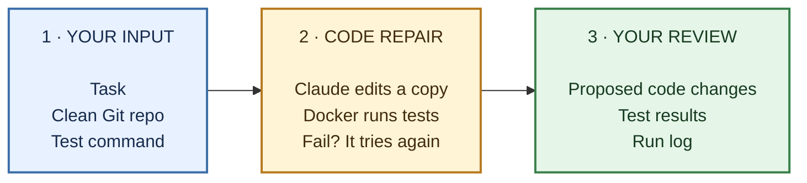

# CodeRepair

CodeRepair is a bounded autonomous coding agent for Python repositories. It
inspects a clean Git snapshot, asks Claude to use five narrow repository tools,
edits only a temporary workspace, runs one pre-approved pytest command in a
restricted Docker container, and returns an auditable patch and report.

The engineering question is deliberately narrower than “build a general coding
assistant”: can iterative, isolated test feedback improve repair outcomes on the
same tasks and basic repository tools? CodeRepair includes a baseline/evaluation
harness so that question can be measured rather than answered by model claims.

## Architecture

Here’s the process at a glance:



The original repo is not edited. Tests run in Docker; hidden evaluation tests
are separate and run only after the agent finishes. You decide whether to apply
the patch.

## What is implemented

- A direct Anthropic Messages API loop with complete conversation history,
  multiple tool calls per turn, ordered `tool_result` messages, local argument
  validation, provider-error handling, and iteration/tool/token/wall budgets.
- Five tools: bounded file listing, ripgrep search, bounded reads, atomic
  exact-text patches, and a fixed approved Docker pytest invocation.
- Clean-HEAD snapshotting with `git archive`; dirty repositories, submodules,
  tracked symlinks, traversal, `.git`, and credential-like paths are rejected.
- Python AST validation before any multi-file patch is committed.
- Docker tests with no network, a non-root UID, dropped capabilities,
  `no-new-privileges`, read-only root/workspace mounts, tmpfs, and CPU, memory,
  process, descriptor, output, and time limits. There is no host fallback.
- JSONL traces and separate reporting for syntax validity, visible tests,
  independent tests, regressions, and verified success.
- Baseline-versus-iterative evaluation with pinned source-tree hashes and hidden
  test isolation.
- An optional approval-gated branch/commit/push/draft-PR command. It never pushes
  by default and never merges or targets the default branch directly.

## Install

Requirements are Python 3.11+, Git, ripgrep (a Python search fallback exists),
and Docker for any test execution. `gh` is needed only for draft PR creation.

```bash
python -m venv .venv
# Linux/macOS: source .venv/bin/activate
# PowerShell:  .venv\Scripts\Activate.ps1
python -m pip install --upgrade pip
python -m pip install -e ".[dev]"
docker build -f docker/test-runner.Dockerfile -t coderepair-sandbox:py311 .
```

Set credentials without committing them:

```bash
export ANTHROPIC_API_KEY="..."
export ANTHROPIC_MODEL="claude-sonnet-5-5"
```

PowerShell equivalents are `$env:ANTHROPIC_API_KEY="..."` and
`$env:ANTHROPIC_MODEL="claude-sonnet-5-5"`. The model is configurable because
IDs and availability change. CodeRepair targets `anthropic>=2,<3` and does not
send removed sampling parameters.

## Run the included repair example

The sample is intentionally broken and is not itself a nested Git repository.
Copy it, create an immutable starting commit, and run CodeRepair:

```bash
cp -R examples/broken_python_repo /tmp/coderepair-auth-demo
cd /tmp/coderepair-auth-demo
git init
git add .
git -c user.name=Demo -c user.email=demo@example.invalid commit -m "broken fixture"
cd -

coderepair run \
  --repo /tmp/coderepair-auth-demo \
  --task "Fix the reversed token expiration behavior without changing tests" \
  --test-command "pytest -q"
```

On PowerShell, use `Copy-Item -Recurse` and a path under `$env:TEMP`. By default,
artifacts go under the operating system's temporary `coderepair-runs` directory,
outside the source repository. The command prints the exact location.

Every run contains:

```text
diff.patch       Git-compatible proposed changes
result.json      structured status, measurements, and verification labels
summary.md       human-readable outcome
trace.jsonl      ordered model/tool execution events
```

The process exits successfully only when visible tests passed for the latest
workspace generation. An `end_turn` statement from the model is reported as
`completed_unverified` when that evidence is absent.

## Custom agent loop

Each turn calls `client.messages.create(...)` with the fixed system policy,
append-only history, strict tool schemas, and a bounded output allowance. The
entire assistant response is retained, including signed thinking blocks used by
current Claude models. Every `tool_use` block is dispatched sequentially. All
corresponding results—including argument or execution errors—are JSON-encoded
into one immediate user message.

This is intentionally implemented in a readable loop rather than LangChain,
LangGraph, CrewAI, or the Claude Agent SDK. `FakeModel` supplies deterministic
responses for offline unit tests.

## Tool and execution policy

`list_files`, `search_code`, and `read_file` exclude common build/cache folders
and credential-like names. All paths are relative POSIX paths; absolute paths,
drive/UNC paths, `..`, backslashes, `.git`, and any symlink component are denied.

`apply_patch` accepts explicit `replace`, `create`, or `delete` operations. A
replacement's old text must occur exactly once. All operations are resolved and
validated in memory, protected test paths are denied, every resulting `.py` file
is parsed, and only then are staged files atomically replaced. A failed
multi-file validation writes nothing.

`run_tests` has an empty input schema: the model cannot provide a command,
image, mount, environment variable, or limit. Those are approved before the
loop. The target workspace is mounted read-only, so tests that write beside
source files must be adapted to use temporary directories.

Docker containment meaningfully reduces exposure but is not a perfect security
guarantee. Do not use it as the sole boundary for deliberately hostile code on a
sensitive host.

## Evaluation

Three deliberately small development fixtures are included. They validate the
harness; they are not evidence of general real-world repair performance.

```bash
coderepair eval --manifest benchmarks/tasks.json --mode both
```

For each task, CodeRepair verifies the canonical source-tree SHA-256 before the
first model request. The baseline receives list/search/read/patch tools but no
test feedback. The iterative configuration additionally receives the approved
visible-test tool. Both start from fresh copies and use the manifest's same model
budgets. After a run, visible, hidden target, and regression tests execute in a
fresh evaluator copy. Hidden files are mounted separately and never enter model
context.

The generated Markdown report includes repair success, visible pass rate,
regression rate, tool calls, iterations, latency, token usage, and cost only when
explicit prices were configured. It preserves infrastructure failures separately
instead of silently counting them as model failures. The comparison does not
perfectly isolate iterative feedback: that configuration necessarily spends
tool time and context on test observations.

No benchmark results are committed or fabricated. Run the command with your
chosen model, image, limits, and pricing, then report the produced measurements
with that configuration.

## Review and apply a patch

`run` never changes the source repository. To apply a completed run, review the
full diff printed by this command:

```bash
coderepair apply \
  --repo /path/to/repo \
  --run-dir /path/to/run-artifacts \
  --branch coderepair/auth-expiration \
  --commit-message "Fix token expiration comparison"
```

Without `--approve`, it exits after review and changes nothing. Rerun with
`--approve` to create a new branch, stage only patch paths, and commit. `--push`
is a second explicit publication choice. `--draft-pr` also requires `--push` and
uses `gh pr create --draft`; CodeRepair never merges a PR.

## Offline project checks

```bash
ruff check .
python -m compileall -q src tests
pytest -m "not integration"
```

Ordinary tests use fake models and mocked Docker command execution, so they need
neither API credits nor a daemon. Opt-in integration tests are marked
`integration`.

## Known limitations

- v1 supports Python repositories and pytest only.
- Target dependencies are not installed automatically. Build and review a fixed
  custom image when a task needs more than Python and pytest.
- Repositories must have a clean, non-bare HEAD and cannot contain submodules or
  tracked symlinks.
- The snapshot includes tracked files only; worktree changes are rejected rather
  than copied implicitly.
- The Docker daemon is a privileged local service. CodeRepair never mounts its
  socket, home directories, or cloud credentials into test containers.
- Model behavior is nondeterministic. The manifest makes procedures and inputs
  reproducible, not outputs identical.
- Syntax validity and visible tests do not prove semantic correctness. Only the
  configured independent evaluation supports the `verified_task_success` label.

See [docs/ENGINEERING.md](docs/ENGINEERING.md) for the interview-oriented design
walkthrough.
